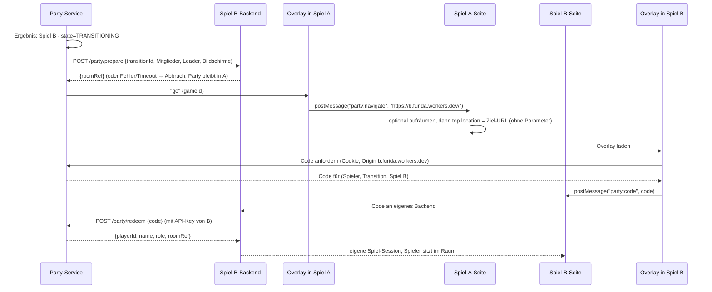

# Globales Party-System – Architekturkonzept

Stand: 21.11.2026 · Status: Phase 1 + 2 umgesetzt in `platform/` (Party-Service + Hub + Overlay) und `server/` (KONTEXTLOS-Anbindung). Noch nicht umgesetzt: große Bildschirme als Party-Mitglieder.
Bezugspunkt für „heute“: KONTEXTLOS (`server/server.js`, `server/game.js`) – Node + WebSocket, Räume im Speicher, 4-Buchstaben-Raumcode, Name ≤ 12 Zeichen, Geräte-ID `dev`, VIP = erster Online-Spieler, optionaler großer Bildschirm (Godot-Web), Render Free (schläft nach Inaktivität).

---

## 0. Kurzfassung

- **Drei Ebenen statt zwei:** Game Hub (Katalog, Startseite) · **Party-Service** (neu: Gast-Identität, Partys, Abstimmung, Übergänge) · unabhängige Spiele.
- **Entschieden: alle Party-fähigen Spiele laufen unter Subdomains einer Plattform-Domain** (`play.furida.workers.dev`, `party.furida.workers.dev`, `kontextlos.furida.workers.dev`, …). Damit sind alle Seiten *same-site*: Das Party-Overlay im Spiel sieht das Identitäts-Cookie des Party-Service direkt.
- **Die Identität liegt als HttpOnly-Cookie auf `party.furida.workers.dev`.** Spiele lesen es nie. Sie erfahren, wer spielt, über einen **einmaligen, 60 s gültigen Übergabecode**, den das Overlay per `postMessage` reicht und das Spiel-Backend serverseitig einlöst. Kein Code und keine ID steht in einer URL.
- **Spiele bleiben souverän:** Sie implementieren zwei kleine Server-Endpunkte (Raum vorbereiten, Code einlösen) und binden ein Overlay-Snippet ein. Engine, Framework und Backend bleiben unberührt.
- **Wichtigster Grundsatz: Graceful Degradation.** Fällt der Party-Service aus, laufen alle Spiele normal weiter – nur ohne Party-Funktionen.
- **Empfehlung zum Start:** Phase 1 ohne Abstimmung (Leader wählt nächstes Spiel) liefert ~90 % des Nutzens. Abstimmung kommt in Phase 2 auf dieselbe Übergangsmechanik.

---

## 1. Gesamtarchitektur

```
                         ┌────────────────────────────────────┐
  Browser (Top-Level)    │  Game Hub  ·  play.furida.workers.dev│
  ───────────────────►   │  Katalog, Party beitreten/erstellen,  │
                         │  /rejoin (Wiederherstellung)          │
                         └───────────────┬────────────────────┘
                                         │ HTTPS + WebSocket
                         ┌───────────────▼────────────────────┐
                         │  Party-Service (neu, eine Instanz)  │
                         │  Identität · Partys · Presence ·    │
                         │  Abstimmung · Übergabecodes ·       │
                         │  Spiele-Registry · Health-Checks     │
                         └──────┬───────────────────┬─────────┘
               Server-zu-Server │ (API-Key je Spiel) │  WebSocket (Overlay)
             ┌──────────────────▼──┐           ┌────▼────────────────────────┐
             │ Spiel-Backend A      │           │ Overlay-iframe im Spiel A/B  │
             │ (z. B. KONTEXTLOS)   │           │ (Party-Leiste, Abstimmung)   │
             └──────────────────────┘           └─────────────────────────────┘
             │ Spiel-Backend B (andere Technik) │
```

**Verantwortungen in einem Satz:**
| Komponente | Besitzt | Besitzt ausdrücklich NICHT |
|---|---|---|
| Game Hub | Katalog, Einstieg, Identitäts-„Heimat“, Wiederherstellung | Spiellogik |
| Party-Service | Wer gehört zusammen, wer führt, wohin geht es als Nächstes | Spielräume, Spielstände, Gameplay |
| Spiel | Räume, Gameplay, Game Host, eigene Sessions | Party-Mitgliedschaft, Abstimmung |

**Bewertete Alternativen für die Kommunikation:**
- *Nur REST-API:* reicht für Identität/Übergänge, aber Abstimmung und Presence in Echtzeit bräuchten Polling → nein.
- *Gemeinsamer Message-Bus, an den alle Spiel-Backends hängen:* koppelt Spiele eng an Infrastruktur, verlangt von jedem Spiel Bus-Clients → unnötig.
- **Empfohlen: kleine REST-Schnittstelle für Spiel-Backends + WebSocket nur zwischen Browser (Overlay/Hub) und Party-Service.** Spiel-Backends müssen nie dauerhaft mit dem Party-Service verbunden sein.

**Technik des Party-Services:** dieselbe wie KONTEXTLOS (Node + `ws`), anfangs **eine Instanz mit Zustand im Speicher**, Partys sind kurzlebig (Stunden). Redis erst, wenn eine zweite Instanz nötig wird. **Nicht auf einem schlafenden Free-Tier** betreiben: Der Party-Service ist das Rückgrat; ein Kaltstart von ~1 Minute während eines Übergangs zerstört das Erlebnis.

---

## 2. Aufgaben des Party-Backends

1. **Gast-Identitäten** ausstellen und prüfen (kein Konto, keine E-Mail).
2. **Partys** anlegen, beitreten, verlassen, kicken; Leader verwalten.
3. **Presence:** wer ist online, wer ist gerade im Übergang, wer ist im Spiel.
4. **Abstimmungen** führen (Zeitgeber, Zählung, Ergebnis).
5. **Übergänge** orchestrieren: Zielspiel vorbereiten, Übergabecodes ausstellen, Fortschritt verfolgen.
6. **Spiele-Registry:** Manifest je Spiel (Origins, URLs, Spielerzahl, API-Key, Integrationsstufe) + Health-Checks.
7. **Echtzeit-Kanal** zu Hub und Overlay.

Bewusst **nicht**: Spielräume hosten, Spielergebnisse speichern, Chat (siehe Erweiterungen), Konten.

---

## 3. Spieler-Identität über die Subdomains

### Warum Subdomains (Entscheidung vom 20.11.2026)
Bei völlig getrennten Domains gäbe es keinen gemeinsamen Speicher: Drittanbieter-Cookies sind praktisch tot, und Browser **partitionieren** den Speicher eingebetteter iframes nach der Top-Level-*Site* (Safari ITP, Chrome/Firefox Storage Partitioning). Partitioniert wird aber nach registrierbarer Domain (eTLD+1), nicht nach Subdomain. Unter `*.furida.workers.dev` ist ein iframe von `party.furida.workers.dev` in `kontextlos.furida.workers.dev` **same-site**: Er bekommt seine normalen Cookies und seinen normalen Speicher. Das spart die komplette Redirect-Mechanik.

Domains:
| Subdomain | Inhalt |
|---|---|
| `play.furida.workers.dev` | Game Hub |
| `party.furida.workers.dev` | Party-Service (API, WebSocket, Overlay-Seite) |
| `<spiel>.furida.workers.dev` | je Spiel, z. B. `kontextlos.furida.workers.dev` |

**Umsetzung ohne gekaufte Domain (entschieden 21.11.2026):** Jede Adresse ist ein kostenloser Cloudflare Worker im Konto mit der Subdomain `furida`, der alle Anfragen inkl. WebSocket an den Render-Dienst durchreicht (`cloudflare/proxy.js`). `workers.dev` steht auf der Public Suffix List, die Site ist also `furida.workers.dev` – alle Worker darunter sind same-site. Render braucht keine eigenen Domains (im Hobby-Plan wären es nur 2). Später kann eine echte Domain (z. B. `furida.eu.org`) die Worker ersetzen; dann gehen nur die Gast-Identitäten verloren.

Die Render-Adressen (`kontextlos.onrender.com`) funktionieren weiter, aber ohne Party. Party-Betrieb findet nur unter `*.furida.workers.dev` statt.

### Modell: „Cookie beim Party-Service + Einmalcodes für Spiele“

1. **Identität = HttpOnly-Cookie `__Host-pid` auf `party.furida.workers.dev`** (`Secure`, `SameSite=Lax`, ohne `Domain`-Attribut, also nur für genau diesen Host). Inhalt: zufälliges Geräte-Geheimnis (256 bit); der Server speichert nur den Hash und ordnet ihm `playerId` zu.
   - Kein JavaScript kann es lesen – weder das des Hubs noch das eines Spiels.
   - Das `__Host-`-Präfix verhindert, dass eine andere Subdomain (z. B. ein kompromittiertes Spiel) ein gefälschtes Cookie für die ganze Plattform-Domain unterschiebt („Cookie Tossing“).
2. **Identität entsteht dort, wo der Spieler zuerst ist.** Hub oder Overlay im Spiel fragen beim Party-Service „wer bin ich?“; gibt es kein Cookie, wird eine neue Gast-Identität angelegt. Ein Umweg über den Hub ist nicht mehr nötig.
3. **Spiele erhalten die Identität nur über einen Übergabecode** (Abschnitt 6). Das Overlay holt ihn mit dem Cookie, reicht ihn per `postMessage` an die Spielseite, das Spiel-Backend löst ihn ein. Das Geräte-Geheimnis verlässt `party.furida.workers.dev` nie.
4. **Spiel direkt geöffnet?** Das Overlay erkennt die Identität sofort. Ist der Spieler in einer Party, zeigt es „Deine Party spielt gerade X – hin?“; sonst bleibt alles wie heute.
5. **Einladungslinks** zeigen weiterhin auf den Hub (`play.furida.workers.dev/p/ABCD`), weil der Hub immer ins *aktuelle* Spiel der Party weiterleitet.

Felder der Identität (Party-Service):
`playerId`, `displayName` (1–12 Zeichen, eindeutig innerhalb der Party), `partyId?`, `partyRole` (leader/member), `currentGame?`, `deviceSecretHash`, `lastSeen`.

> **Hinweis zur Namenslänge:** KONTEXTLOS schneidet bei 12 Zeichen ab. Die Plattform sollte das kleinste gemeinsame Limit erzwingen, sonst heißen Spieler in verschiedenen Spielen verschieden. Im Integrations-Spec festlegen: max. 12, Spiele dürfen nicht weiter kürzen.

**Kritische Bewertung:** Gerät/Browser verloren ⇒ Identität verloren. Für eine kostenlose Gast-Plattform akzeptabel; spätere Abhilfe: Passkey oder Wiederherstellungscode (optional, kein Konto-Zwang).

### Grenzen
- Nur Worker *innerhalb* des Kontos `furida` sind same-site. Ein Spiel in einem anderen Cloudflare-Konto wäre eine fremde Site.
- Cloudflare Free: 100.000 Anfragen/Tag. WebSocket-Nachrichten laufen durch, die Verbindung zählt als eine Anfrage.
- Das Overlay funktioniert nur, wenn das Spiel wirklich unter `*.furida.workers.dev` geöffnet wird. Unter `kontextlos.onrender.com` gibt es keine Party – deshalb zeigen alle Links und QR-Codes auf die Worker-Adresse (`PUBLIC_URL`).
- Privatmodus / „alle Cookies blockieren“: keine dauerhafte Identität, Party nur für die Dauer des Tabs. Akzeptabel.

---

## 4. Party-Lebenszyklus und Zustand

### Datenmodell
```
Party
  partyId        intern, nie in URLs
  joinCode       kurz (z. B. 4–6 Zeichen), rotierbar, nur zum Beitreten
  leaderId
  members[]      { playerId, name, joinedAt, status, lastSeen, device: phone|screen }
  activeGame     { gameId, roomRef (opak, vom Spiel), since }
  state          IDLE | IN_GAME | VOTING | TRANSITIONING
  vote?          (Abschnitt 5)
  transition?    { id, gameId, roomRef, startedAt, redeemed[] }
  settings       { whoMayStartVote: leader|everyone, voteSeconds, maxMembers }
  version        steigt bei jeder Änderung (Clients verwerfen veraltete Updates)
```
Mitglieds-`status`: `online` · `away` (Verbindung weg, Gnadenfrist) · `transitioning` · `in_game` · entfernt.

### Zustandsautomat
```
            erstellen
               │
             IDLE ──(Leader wählt erstes Spiel)──► TRANSITIONING
               ▲                                   │      │
               │                       Ziel bereit │      │ Ziel nicht verfügbar
               │                                   ▼      ▼
               └──── alle weg ────────────── IN_GAME ◄── (zurück zum vorigen Zustand)
                                              │  ▲
                              Abstimmung      │  │ niemand/„Weiterspielen“ gewinnt
                              starten         ▼  │
                                             VOTING ──(anderes Spiel gewinnt)──► TRANSITIONING
```

### Große Bildschirme (KONTEXTLOS-spezifisch, aber generell wichtig)
KONTEXTLOS kennt einen **Bildschirm, der kein Spieler ist** (TV/Beamer). Die Party braucht daher Mitglieder vom Typ `screen`: zählen nicht als Wähler, wechseln aber beim Übergang mit – auf die *Host-URL* des Zielspiels, falls es einen Bildschirm unterstützt (Manifest: `screenUrl`), sonst auf eine Hub-Seite „Dieses Spiel läuft auf den Handys“.

### Aufräumen
- Mitglied ohne Verbindung > 10 min ⇒ entfernt (entspricht der Raum-Aufräumzeit von KONTEXTLOS).
- Party ohne Online-Mitglied > 30 min ⇒ gelöscht. Harte Obergrenze 24 h.
- Keine dauerhafte Datenbank nötig; Partys sind flüchtig.

---

## 5. Abstimmungslogik

### Regeln (Empfehlung)
| Regel | Festlegung |
|---|---|
| Wer darf starten | Einstellung `leader` (Standard) oder `everyone`. Bei `everyone`: 60 s Abklingzeit nach einer gescheiterten Abstimmung gegen Spam. |
| Optionen | Alle Spiele, die zur aktuellen Spielerzahl passen **und** gerade gesund sind, **plus „Weiterspielen“ (aktuelles Spiel)** als ausdrückliche Option. |
| Stimmen | Eine pro `playerId` (nicht pro Verbindung/Tab), bis zum Ende änderbar. Bildschirme stimmen nicht ab. |
| Dauer | Standard 30 s, einstellbar 15–90 s. **Vorzeitiges Ende**, sobald alle aktiven Wähler abgestimmt haben. |
| Wertung | Relative Mehrheit der abgegebenen Stimmen. Kein Quorum (bei Partyspielen frustriert ein Quorum mehr, als es schützt). |
| Keine Stimmen | Aktuelles Spiel bleibt. |
| Gleichstand | 1) Ist „Weiterspielen“ beteiligt → bleibt (Status quo gewinnt). 2) Sonst entscheidet die Stimme des Leaders, falls sie unter den Gleichständen ist. 3) Sonst Server-Zufall, das Ergebnis wird mit „per Los“ angezeigt. |
| Abbruch | Leader kann abbrechen. Kein „Leader-Override“ für das Ergebnis – sonst ist die Abstimmung Theater. |

### Aktive Wähler
- Beim Start: alle Mitglieder mit Status `online`/`in_game`.
- Wer während der Abstimmung länger als **15 s** getrennt ist, zählt nicht mehr für das vorzeitige Ende; eine bereits abgegebene Stimme bleibt gültig (sie war eine echte Willensäußerung).
- Wer während der Abstimmung beitritt, darf abstimmen und wird aktiver Wähler.
- Nur eine Abstimmung gleichzeitig; während `TRANSITIONING` keine.

### Laufendes Spiel während der Abstimmung
Spiel A läuft weiter, das Overlay legt sich nur über einen Teil des Bildschirms. Spiele können über das SDK optional „gerade ungünstig“ melden (z. B. mitten in der Antwortphase); dann zeigt das Overlay die Abstimmung minimiert an. **Kein Blockieren durch das Spiel** – sonst kann ein hängendes Spiel die Party festhalten.

### Aufwärmen beim Abstimmungsstart
Beim Start der Abstimmung pingt der Party-Service die Health-Endpunkte **aller** Optionen. Schlafende Free-Tier-Server (wie KONTEXTLOS auf Render) wachen so während der 30 s auf, statt erst nach dem Ergebnis. Nicht antwortende Spiele werden als „gerade nicht erreichbar“ ausgegraut.

---

## 6. Übergänge zwischen den Spielen

### Ablauf


Die Ziel-URL ist die **nackte Spiel-URL** – kein Code, keine ID, kein Name. Wer sie kopiert und teilt, teilt nichts. Wer sie ohne Party öffnet, landet einfach im Spiel.

### Der Übergabecode
- **Opak, 128 bit, einmalig, 60 s gültig**, gebunden an `playerId + transitionId + gameId`.
- Ausgestellt nur auf eine Anfrage **mit gültigem Identitäts-Cookie** und `Origin` = registrierte Subdomain des Spiels, in dem die Party gerade ist (bzw. in das sie wechselt).
- Einlösbar **nur vom Backend dieses Spiels mit dessen API-Key** ⇒ ein abgefangener Code nützt weder einem fremden Spiel noch einem Angreifer ohne den Server-Schlüssel.
- Atomar entwertet beim ersten Einlösen.
- Wandert nur per `postMessage` (Origin geprüft) und Server-Anfrage, **nie durch eine URL**. Weil das Overlay jederzeit einen neuen Code holen kann, ist ein abgelaufener Code kein Fehlerfall mehr, sondern wird einfach erneuert.

### Warum zwei Schritte (prepare, dann Codes)?
`prepare` ist gleichzeitig die **Verfügbarkeitsprüfung**: Erst wenn Spiel B einen Raum zugesagt hat, wird irgendjemand umgeleitet. Niemand landet auf einer kaputten Seite, die Party bleibt sonst geschlossen in Spiel A.

### Warum das Overlay nicht selbst umleitet
Browser blockieren, dass ein Cross-Origin-iframe ohne Nutzerinteraktion die Top-Level-Seite umleitet (Framebusting-Schutz). Deshalb braucht die Spielseite ein **winziges Snippet** (~20 Zeilen), das die `postMessage` vom Overlay (Origin geprüft) entgegennimmt und navigiert. Das ist der einzige Code, den jedes Spiel im Frontend braucht.

### Automatischer Wiedereintritt
Das Spiel bekommt beim Einlösen `roomRef` und setzt den Spieler direkt in den Raum – keine Lobby-Suche, kein Raumcode. Bei KONTEXTLOS entspricht das `joinAs(room, name, dev)` mit dem Party-Namen.

### Mobile Besonderheit
Gesperrte Handys / Hintergrund-Tabs empfangen keine WebSocket-Nachrichten. Beim Zurückkehren synchronisiert das Overlay den Party-Zustand (`version`) und führt einen verpassten „go“ nach – mit **frisch angefordertem** Code, falls der alte abgelaufen ist.

---

## 7. Integrationsschnittstelle für Spiele

### Integrationsstufen
| Stufe | Spiel tut | Ergebnis |
|---|---|---|
| 0 | nichts | Spiel erscheint im Hub-Katalog, ist aber kein Abstimmungsziel. |
| 1 | läuft unter `<spiel>.furida.workers.dev`, `prepare` + `redeem`, Overlay-iframe + Snippet (Navigation, Code entgegennehmen) | Party kann in das Spiel wechseln, dort abstimmen und weiterziehen. |

Weil das Overlay jetzt die Quelle des Übergabecodes ist, gibt es keinen sinnvollen Zwischenschritt „nur hinein, nicht heraus“ mehr – zwei Stufen reichen.

Neue Spiele können mit Stufe 0 starten; nichts zwingt zu sofortiger Integration.

### Spiel-Manifest (im Party-Service registriert)
`gameId`, Name, Bild, erlaubte Origins, `playerUrl`, `screenUrl?`, `minPlayers`, `maxPlayers`, `prepareEndpoint`, `healthEndpoint`, API-Key (gehasht), Spec-Version.

### Endpunkte
- **Spiel implementiert:** `POST prepare` (Raum anlegen, `roomRef` zurück), `GET health`.
- **Party-Service bietet:** `POST redeem`, optional `POST events` (z. B. „Raum beendet“, „Spieler aus Raum gekickt“) – damit die Party weiß, was im Spiel passiert, ohne das Spiel zu steuern.
- Spec versioniert (`v1`), Änderungen nur additiv.

### Rollen: Party Leader vs. Game Host
**Getrennt halten.** Der Leader organisiert die Party (Abstimmung starten, kicken aus der Party, Einstellungen). Der Game Host ist ein Konzept des einzelnen Spiels – bei KONTEXTLOS ist das sogar ein *Gerät* (der Bildschirm) bzw. der VIP (erster Online-Spieler).
Kopplung nur als **Vorschlag**: `prepare` liefert die Mitglieder in Reihenfolge *Leader zuerst*. KONTEXTLOS macht daraus ohne Änderung den VIP, weil `vip = online(r)[0]`. Andere Spiele dürfen anders entscheiden.

### KONTEXTLOS konkret (ohne Umbau des Spiels)
- `prepare` → `newRoom()` mit Party-Markierung, Rückgabe des Raumcodes als `roomRef`.
- Code einlösen → bestehender `join`-Pfad mit Party-Name; `dev` = aus `playerId` abgeleitete, spielspezifische ID, damit Bans weiter funktionieren.
- Worker `kontextlos` (Ziel `kontextlos.onrender.com`) und auf Render `PUBLIC_URL=https://kontextlos.furida.workers.dev` – QR-Codes und Links zeigen dann auf die Worker-Adresse. Handy-Seite und Godot verbinden sich über `location.host` und brauchen keine Änderung.
- Phone-Seite (`public/index.html`) und Godot-HTML-Shell bekommen Overlay + Snippet. Die Rejoin-ID `pid` im localStorage bleibt unverändert – sie ist spielintern.
- Render Free schläft: Aufwärmen beim Abstimmungsstart (Abschnitt 5) deckt das ab; sonst Starter-Plan.

---

## 8. Sicherheit

| Thema | Maßnahme |
|---|---|
| Identität | Geräte-Geheimnis nur auf Hub-Origin, Server speichert Hash. |
| Übergabecode | 128 bit, 60 s, einmalig, an Spiel gebunden, nur mit Spiel-API-Key einlösbar, nie in einer URL. |
| Cookie-Anfragen (CSRF / Cross-Site-WebSocket-Hijacking) | Das Cookie geht bei jeder same-site-Anfrage mit – auch von einem kompromittierten Spiel. Deshalb prüft der Party-Service bei **jeder** Anfrage und beim WebSocket-Aufbau den `Origin` gegen eine feste Liste (`party.`, `hub.` und registrierte Spiel-Subdomains). Zustandsändernde Aktionen (Stimme, Kick, Leader) laufen nur über den WebSocket bzw. POST mit Origin-Prüfung, nie über GET. |
| Subdomain-Hygiene | Keine Subdomain mit fremd gehostetem Nutzerinhalt im Cloudflare-Konto `furida`; jede Spiel-Subdomain ist eine registrierte, eigene Anwendung. Cookie mit `__Host-`-Präfix gegen Cookie Tossing. |
| Spiele untereinander | API-Key je Spiel; ein Spiel kann nur Codes für sich selbst einlösen. |
| iframes | `frame-ancestors` des Overlays auf registrierte Spiel-Origins beschränken; `postMessage` beidseitig mit Origin-Prüfung. |
| Beitreten | `partyId` nie öffentlich; nur `joinCode` (rotierbar, rate-limitiert gegen Durchprobieren). Party-Kick/Bann durch Leader. |
| Missbrauch | Rate-Limits für Abstimmungsstart, Stimmen, Beitritte. Namen: Unicode-normalisieren, Länge, Eindeutigkeit, Wortfilter. |
| Datenschutz / Kinder | Keine Konten, keine E-Mail, keine Freitext-Chats im Kernsystem, keine IPs in Partydaten, alles flüchtig. Das hält die DSGVO-Last minimal und ist bei jungen Spielern der sicherste Ausgangspunkt. |

---

## 9. Fehlerbehandlung und Wiederherstellung

**Universeller Rettungsweg:** Weil Hub *und* Overlay die Identität per Cookie kennen, weiß jede Plattform-Seite jederzeit, wo die Party gerade ist. Das Overlay zeigt bei Abweichung „Deine Party ist in X – hin?“, der Hub dasselbe als Banner. `play.furida.workers.dev/rejoin` bleibt als einfacher Link für Fehlerseiten der Spiele.

| Szenario | Verhalten |
|---|---|
| Spieler trennt sich während Abstimmung | 15 s Gnadenfrist, danach kein aktiver Wähler mehr; abgegebene Stimme zählt. |
| Spieler trennt sich während Übergang | Er hat noch keinen Code (der wird erst im Zielspiel geholt). Kommt er zurück, egal auf welche Plattform-Seite, führt ihn das Overlay/der Hub ins aktuelle Spiel. |
| Zielspiel lädt beim Spieler nicht | Nach 60 s ohne Einlösen Status `lost`; andere sehen „Lisa hängt noch“. Overlay/Hub bietet „Erneut versuchen“. |
| Browser während Übergang geschlossen | Beim nächsten Hub-Besuch: Banner „Deine Party spielt gerade KONTEXTLOS – zurück?“ (ein Tipp). |
| Leader trennt sich | 60 s Gnadenfrist (Neuladen soll nichts kaputt machen), dann wird das am längsten anwesende Online-Mitglied Leader. Kein automatisches Zurückfallen bei Rückkehr (vermeidet Hin-und-her). |
| Abgelaufener / benutzter Code | Spiel-Backend meldet Fehler, Overlay holt automatisch einen neuen Code (ein Versuch). Ist der Spieler kein Mitglied mehr, spielt er normal ohne Party weiter. |
| Zielspiel nicht verfügbar | `prepare` scheitert/Timeout (20 s, ein Wiederholversuch) ⇒ Übergang abgebrochen, alle bleiben in Spiel A, Meldung im Overlay, Spiel 5 min aus Abstimmungen ausgeblendet. |
| Beitritt zu Party, die das Spiel gewechselt hat | Einladungslinks zeigen auf den Hub, nicht aufs Spiel ⇒ der Hub schickt immer ins *aktuelle* Spiel. Alte Spiel-Raumlinks verhalten sich wie heute („Raum nicht gefunden“) plus Hinweis „Zur Party“. |
| Party-Service fällt aus | Spiele laufen weiter, Overlay zeigt „Party gerade nicht erreichbar“. Kein Spiel darf vom Party-Service abhängen, um *weiterzulaufen*. |
| Spiel A wird während Übergang neu deployt (KONTEXTLOS lädt bei neuem `BUILD` neu) | Unkritisch: Overlay synchronisiert nach dem Neuladen über `version`. |

---

## 10. Kritische Bewertung – Schwachstellen des Konzepts

1. **Neuer Single Point of Failure.** Der Party-Service ist zentral. *Gegenmittel:* strikte Graceful Degradation (oben), Spiele hängen nur für Party-Funktionen daran, nie für Gameplay.
2. **Subdomains schaffen eine gemeinsame Vertrauenszone.** Alle Spiele sind same-site zum Party-Service; ein kompromittiertes Spiel kann Anfragen *mit* dem Identitäts-Cookie auslösen (lesen kann es das Cookie nicht). *Gegenmittel:* Origin-Prüfung überall, `__Host-`-Cookie, nur eigene/geprüfte Spiele unter der Domain. Spiele von Fremdentwicklern (Phase 3) bräuchten ggf. eine strengere Variante: eigene Domain, Identität per Top-Level-Redirect zum Hub und Einmalcode zurück (OAuth-Muster).
3. **Zwei Lobbys im Kopf der Spieler.** Party und Spielraum sind verschiedene Dinge. Wenn das Spiel nach dem Übergang erst wieder eine eigene Lobby mit Code zeigt, ist die Illusion kaputt. *Gegenmittel:* Spiel-Lobby wird bei Party-Räumen automatisch befüllt, Raumcode tritt in den Hintergrund.
4. **Unterbrechung laufender Runden.** Eine Abstimmung mitten in einer Runde nervt. *Gegenmittel:* Standard „nur Leader startet“, minimierte Darstellung bei „ungünstig“-Signal.
5. **Mobile Browser sind unzuverlässige Echtzeit-Clients.** Gesperrte Handys wirken wie Disconnects. *Gegenmittel:* großzügige Gnadenfristen, Zustandsabgleich per `version`, frische Codes bei Rückkehr.
6. **Overlay über fremden Spielen.** Jedes Spiel hat andere Layouts (Godot-Canvas, Handy-UI). Ein Overlay, das überall gut aussieht, ist Designarbeit. *Gegenmittel:* sehr kleine, einklappbare Leiste; volle Fläche nur während der Abstimmung.
7. **Gefahr der Überkonstruktion.** Presence, Rollen, Abstimmungen, Token-Arten – das wächst schnell. *Gegenmittel:* Phasenplan unten; jede Phase ist für sich nützlich.
8. **Kaltstarts kostenloser Hosts.** Spiele auf schlafenden Free-Tiers machen jeden Übergang langsam. Aufwärmen hilft, löst es aber nicht ganz.

---

## 11. Empfohlene Endstruktur und Phasenplan

**Struktur:** Hub (statisch) · Party-Service (eine Node-Instanz, Speicher-Zustand, immer an) · Spiele mit Integrationsstufe 0–1. Kommunikation: REST Spiel↔Party, WebSocket Browser↔Party, Identitäts-Cookie auf `party.furida.workers.dev`, Einmalcodes per `postMessage` für Spiel-Backends, alles unter `*.furida.workers.dev`.

| Phase | Inhalt | Nutzen |
|---|---|---|
| 1 | Gast-Identität, Party erstellen/beitreten über Hub, Leader wählt nächstes Spiel, Übergang mit Codes, `/rejoin`. Plattform-Domain + Subdomains einrichten, KONTEXTLOS + ein zweites Spiel auf Stufe 1. | Kernversprechen „wir bleiben zusammen“ erfüllt. |
| 2 | Abstimmung mit allen Regeln, Aufwärmen, Health-Ausblendung, Einstellung „jeder darf starten“. | Demokratische Spielwahl. |
| 3 | Redis + mehrere Instanzen, Integrations-SDK/Doku für Fremdentwickler, Monitoring der Übergangs-Erfolgsquote. | Skalierung auf viele Spiele. |

---

## 12. Erweiterungsmöglichkeiten

- Optionale Konto-Aufwertung (Passkey/Wiederherstellungscode) für geräteübergreifende Identität.
- Freundesliste, „Party-Einladung an Freund“.
- Party-übergreifende Punkte/Abende („Heute Abend: 3 Spiele, Gesamtsieger“).
- Öffentliche Partys / Matchmaking für Spieler ohne Gruppe.
- Moderierter Party-Chat oder nur Emoji-Reaktionen (kindersicherer).
- Zuschauer-Rolle, Warteschlange bei vollem Spiel.
- Spiele-Playlists („3 Runden KONTEXTLOS, dann Abstimmung“).
- Mehrsprachigkeit über das Manifest.
- Analysen: Übergangs-Erfolgsquote, Abbruch nach Spielwechsel, beliebteste Spielfolgen.
